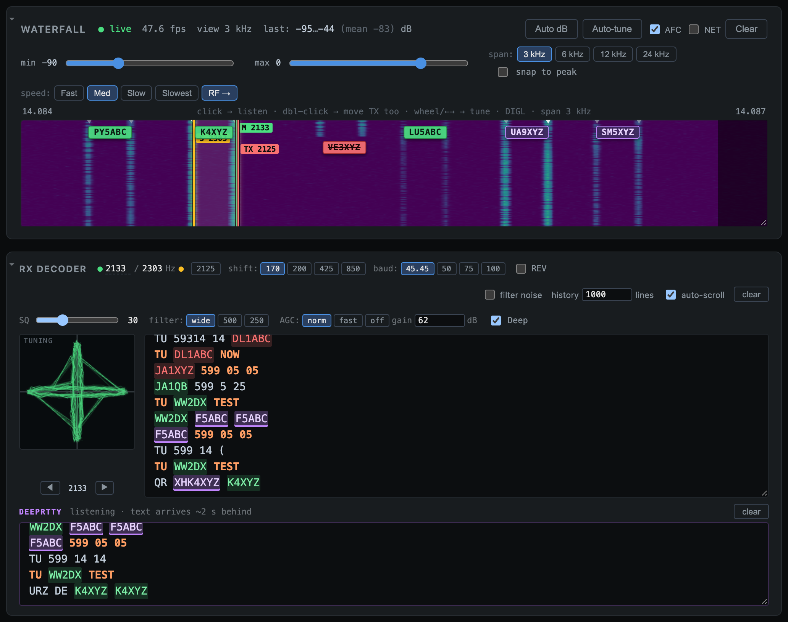

# 2. Receiving

## The waterfall

The waterfall shows the receive audio passband. A RTTY signal shows up as two parallel lines, mark and space, 170 Hz apart. The markers on top show where Diddle is listening:

- **M** is your receive mark tone.
- **TX** is your transmit mark tone, when it differs from receive.
- The shaded edges are outside the radio's RX filter.

### Clicking and tuning

| Action | Result |
|--------|--------|
| **Click** (Run) | Moves *receive only*. Use it to copy a caller who's off frequency while you stay on your run frequency. |
| **Double-click** (Run) | Moves receive *and* transmit: a new run frequency. |
| **Click** (S&P) | Moves both. You answer a CQ on his frequency. |
| **Mouse wheel** over the waterfall | Tunes the radio 10 Hz a step (Shift: 100 Hz, Alt/Option: 1 kHz). The signals slide under fixed markers, like turning the VFO knob. |
| **← / →** (waterfall focused) | Same as the wheel. |
| **PgUp / PgDn** (anywhere) | Tunes the dial ±1 kHz. |

When you log a Run QSO, receive goes back to your transmit frequency, ready for the next caller.

**Snap to peak** moves a click to the strongest signal within ±150 Hz, so you don't have to hit the line exactly. Turn it off to set the mark exactly where you click.

### Callsign tags

Diddle runs up to **12 extra decoders** at once, one on each RTTY signal it finds in the passband. When one of them decodes a station's CQ, a tag with his call appears over his signal:

- **Green:** a new station.
- **Purple:** a new multiplier on this band.
- **Red, struck through:** already worked on this band (a dupe).

Tags follow the station that's **running** there: the call that goes with a `CQ`, `TEST` or `QRZ`. Stations calling him don't get a tag. A station's tag appears once one of his CQs has been decoded, and a tag is only shown when the call is in the SCP database, which keeps noise out.

- **Click a tag:** loads the call, tunes onto the signal, and switches to **S&P**.
- **Right-click a tag:** adds the station to the caller stack without tuning (see [Operating](03-operating.md#the-caller-stack)).

Cluster spots also appear as tags (see [Bandmap](04-bandmap-cluster.md)).

### Waterfall controls

| Control | What it does |
|---------|--------------|
| **min / max** sliders, **Auto dB** | Brightness range. Auto dB sets it from the current noise. |
| **Auto-tune** | Finds the best RTTY pair among the visible signals and tunes to it. |
| **AFC** | Pulls receive onto a caller within ±15 Hz of your TX mark, and snaps back each time you unkey, so it can't wander onto a neighbour. It's on in Run and off in S&P automatically; tick it to override. |
| **NET** | Lets transmit follow AFC (MMTTY's NET). Off: your signal holds still while AFC follows drift. |
| **span** 3 / 6 / 12 / 24 kHz | How much of the passband is shown. |
| **speed** | How fast the waterfall scrolls. |
| **RF →** | Flips the display to RF order, so higher frequencies are on the right. |

## The RX decoder

The main RX window prints what the station on your receive tones is sending. The text is **clickable**:

- **Click a callsign** to load it into the Call field.
- **Right-click a callsign** to add it to the caller stack.
- **Click any other word** (a zone, state, serial or name) to add it to the Exch field. The first click replaces an empty or history-filled Exch; later clicks append. So for `599 05 MA`, click `05`, then `MA`.

Calls use the same colours as the tags: green new, purple new mult, red struck dupe. Text you transmit is shown too, so you can see both sides of the QSO.

### Decoder settings

| Control | What it does |
|---------|--------------|
| **Mark** (Hz) | Your mark tone. Type a value and press Enter; it moves receive and transmit together. **2125** resets to the standard tone, so a dial frequency means the same thing as in MMTTY. |
| **shift** 170 / 200 / 425 / 850 | Tone spacing. Contests use 170. |
| **baud** 45.45 / 50 / 75 / 100 | Contests use 45.45. |
| **REV** | Swaps mark and space. Leave it off in DIGL. |
| **filter noise** | Prints only lines with a known callsign or contest word in them. |
| **history** | How many lines to keep. |
| **auto-scroll** | Keeps the newest line in view. Scrolling up pauses it; **Jump to latest** brings it back. |
| **SQ** (squelch) | How clean a signal must be before it prints. At 0 everything prints, noise included. Raise it until the noise between signals stops printing. Weak stations go quiet first, so don't overdo it. |
| **filter** wide / 500 / 250 | The radio's RX filter, set over TCI. 500 and 250 centre on your tones and follow them as you retune; they also hide the rest of the band from the waterfall and bandmap. *wide* restores the radio's own filter. If the tones end up off-centre in a narrow filter, a **⇥ centre** button appears; click it to move the tones to the middle. |
| **AGC** norm / fast / off | The radio's AGC. *off* stops a strong neighbour from pumping the receiver; set **gain** by hand then. |
| **gain** (dB) | With AGC off, it's the fixed gain. With AGC on, turning it down caps the gain, which lets only the strongest caller in a pileup through. |
| **Deep** | Turns DeepRTTY on or off (see below). |

### DeepRTTY

**DeepRTTY** is a neural-network decoder ([e04/DeepRTTY](https://github.com/e04/DeepRTTY)) that runs beside the classic one, in its own pane below the RX window. In testing it copies about **4 dB deeper** into the noise. It's often readable when the classic decoder prints garbage through QSB and QRM, and saves you asking for a repeat.

Its text arrives **about 2 seconds late**, so read the classic pane first and look at DeepRTTY when the classic copy is broken. It works at 45.45 baud / 170 Hz only. Clicking calls and exchange words works the same in both panes.

### The tuning scope

The **crossed-bananas** display at the left of the RX window is for netting by eye. A correctly tuned signal makes a clean **+**. The **◀ ▶** buttons under it nudge the mark 5 Hz at a time (hold to repeat), and so do **Shift+PgUp / Shift+PgDn** from anywhere. A nudge moves receive and transmit together.

Next: **[Operating →](03-operating.md)**
