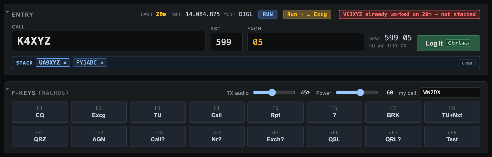

# 3. Operating

## The entry window

| Field | Notes |
|-------|-------|
| **Call** | His call. Type, or click one in the RX window, on the waterfall or in the bandmap. |
| **RST** | Defaults to 599. |
| **Exch** | His exchange, as the contest needs it (the placeholder shows the format). Type it, click words in the RX window, or let call history fill it in. |

Next to the fields you'll see:

- **SENT:** the exchange you're sending.
- **Run / S&P:** the operating mode. Click it or press **Alt+U** to switch.
- **The ESM chip:** what the next Enter will do.
- **A `NEW: Zone 14 · Ukraine` tag** while the call in the form would be a new multiplier. A dupe warning shows instead if it's already worked on this band.

### Moving around

- **Space** jumps between Call and Exch. From Exch it only jumps while Exch is empty, because NAQP exchanges like `JOHN MA` need a real space.
- **Tab / Shift+Tab** cycle Call → RST → Exch.
- **Esc** closes the suggestion list; if it's already closed, Esc clears the form. During a transmission, Esc stops it instead.
- **Ctrl+W** or **Alt+W** wipes the form.

### Call suggestions (SCP)

As you type a partial call, matching calls from the SCP database appear under the Call field. Use **↑ / ↓** to pick one, and **Tab** or **Enter** to take it.

### Type a frequency to QSY

Type a frequency in kHz into Call (for example `14080` or `14080.5`) and press Enter. Diddle sets the dial so a signal on that frequency lands on your mark tone. The ESM chip shows `↵ QSY 14.080` while you type.

## Run and S&P

- **Run:** you're calling CQ and stations come to you.
- **S&P (Search & Pounce):** you're tuning the band and answering other people's CQs.

The mode changes what Enter sends (below), how a waterfall click behaves, and whether AFC is on. **Clicking a bandmap spot or a waterfall tag switches to S&P automatically**, since you're about to answer that station.

## ESM (Enter Sends Message)

With ESM on (Settings, on by default), you work a whole QSO with the Enter key, the same way as in N1MM. The ESM chip always shows what the next Enter will do.

**Run**

| Form | Enter sends | Then |
|------|-------------|------|
| Empty | **F1** (CQ) | |
| Call entered | **F2** (his call + your exchange) | Focus jumps to Exch |
| Exchange sent, Exch still empty | **F2** again | That's how you ask for a repeat |
| Call + his exchange | **F3** (TU) | QSO logged |
| Call + exchange, callers stacked | The **stack-TU macro** (F8) | TU, log, next caller, your exchange: all in one transmission |

**S&P**

| Form | Enter sends | Then |
|------|-------------|------|
| Empty | **F4** (your call) | Blind call; type his call while you wait |
| Call, no exchange yet | **F4** (your call) | Again on each Enter until he answers |
| Call + his exchange | **F2** (your exchange) | QSO logged |

In S&P Diddle doesn't send TU. That's the running station's job, and your F3 ends in `CQ`, which nobody wants on his frequency.

**Good to know:**

- **Enter while transmitting** queues the next message instead of being refused, so you can press it early.
- **Pressing F3 by hand** in Run with ESM on logs the QSO, just like ESM's TU step.
- **Changing the call** to a different station restarts the sequence. Clicking the *same* call again keeps the exchange you've already entered.
- **Out of sequence?** **Ctrl+Enter** (or the **Log it** button) logs whatever is in Call and Exch without sending anything. It's the way out of any tangle.
- **ESM off:** Enter only logs, and you send everything with F-keys.

## The caller stack

In a pileup you often copy two or three calls at once. **Right-click** each extra caller, in the RX window or on a waterfall tag, to put him on the **stack** (N1MM and WriteLog call it "NEXT"):

- If Call is empty, the first one goes straight into Call.
- The rest wait on the **STACK** line under the entry fields, in the order you clicked.
- A dupe, a call already on the stack, or one stacked in the last 3 minutes is refused, with a short note saying why.

At the TU step, ESM sends the **stack-TU macro** (F8 by default): `TU <CALL><LOGIT> NOW<CRLF><POPSTACK><CALL> 599 …`. That thanks and logs this station, loads the next one, and sends him your exchange in one go. The next Enter is then his TU.

- **Click a call on the stack**, or press **Alt+X**, to drop it.
- **clear** empties the stack.
- Settings → *ESM TU with callers stacked sends* picks which macro is used.

## F-keys and macros

Sixteen macros: **F1–F8**, and **Shift+F1–F8** on the second row. Press the key or click the button.

| Key | Default | | Key | Default |
|-----|---------|-|-----|---------|
| F1 | CQ | | ⇧F1 | QRZ |
| F2 | Exchange | | ⇧F2 | AGN |
| F3 | TU | | ⇧F3 | CALL? |
| F4 | Your call | | ⇧F4 | NR? |
| F5 | Repeat exchange | | ⇧F5 | EXCH? |
| F6 | PSE AGN ? | | ⇧F6 | QSL TU |
| F7 | BRK | | ⇧F7 | QRL? |
| F8 | TU + next (stack) | | ⇧F8 | MYCALL TEST |

F1–F4 are the ESM slots: CQ, exchange, TU and your call. Keep their *purpose* even if you change the text.

Edit labels and text in **Settings → F-key macros**. **↺** restores one slot and **Reset all** restores all of them. Changes save as you type, and into the active saved setup if there is one.

### Macro tokens

| Token | Becomes |
|-------|---------|
| `<MYCALL>` | Your call |
| `<CALL>` | His call (from the Call field) |
| `<SERIAL>` | The next serial number, as 3 digits |
| `<NAME>` `<STATE>` `<CQZONE>` (or `<ZONE>`) `<GRID>` `<AGE>` | Your details from Settings (grid as 4 characters, age `01` if blank) |
| `<CRLF>` | A new line on his screen |
| `<LOGIT>` | Log the QSO at this point. A later `<SERIAL>` is the next number. |
| `<POPSTACK>` | Load the next stacked caller. A later `<CALL>` is him. |

Tokens aren't case-sensitive. Anything Diddle doesn't recognise is sent exactly as typed.

**Tip for a QRM'd exchange:** a macro like `<CALL> <CALL> 599 <CQZONE> <STATE> <CALL>` with his call at both ends gets through when his pileup keeps calling over you. Pressing it doesn't change the ESM step, so your next Enter still sends TU once his exchange is in Exch.

### Chaining, aborting, levels

- **Chaining:** pressing F-keys back to back queues each one onto the transmission already on the air.
- **Esc** stops the transmission at once and drops PTT.
- **TX audio** (F-keys panel) sets the level of the audio sent to the radio. Turn it down until the ALC barely moves; a pinned ALC splatters.
- **Power** sets the radio's RF output over TCI.

## Live keyboard sending

Press **Ctrl+K** (or **Alt+K**) to open the **Ad-hoc send** window and type to the other station live. It keys up as soon as it opens and sends idle (diddle) between keystrokes, so he hears you straight away.

| Mode | Sends |
|------|-------|
| **Word** (default) | Each word when you press Space |
| **Char** | Each key as you type it |
| **Line** | A whole line when you press Enter |

**Enter** sends whatever is left and unkeys. **Esc** aborts. F-keys pressed meanwhile join the same transmission. After 30 seconds with nothing typed, it unkeys by itself. **↑ / ↓** recall earlier lines.

## Fixing the log on the fly

| Keys | Does |
|------|------|
| **Ctrl+Q** | Edit the last QSO's call. **Tab** switches to its exchange. **↑ / ↓** (or Ctrl+Q again) step to older QSOs. Enter saves, Esc cancels. |
| **Ctrl+N** | Add or edit a note on the last QSO (↑ / ↓ for older ones). |
| **Ctrl+D** | Delete the last QSO. Press it twice within 3 seconds to confirm. |

You can also edit any field by clicking it in the Log, or delete with **×**.

Next: **[Bandmap and DX cluster →](04-bandmap-cluster.md)**
