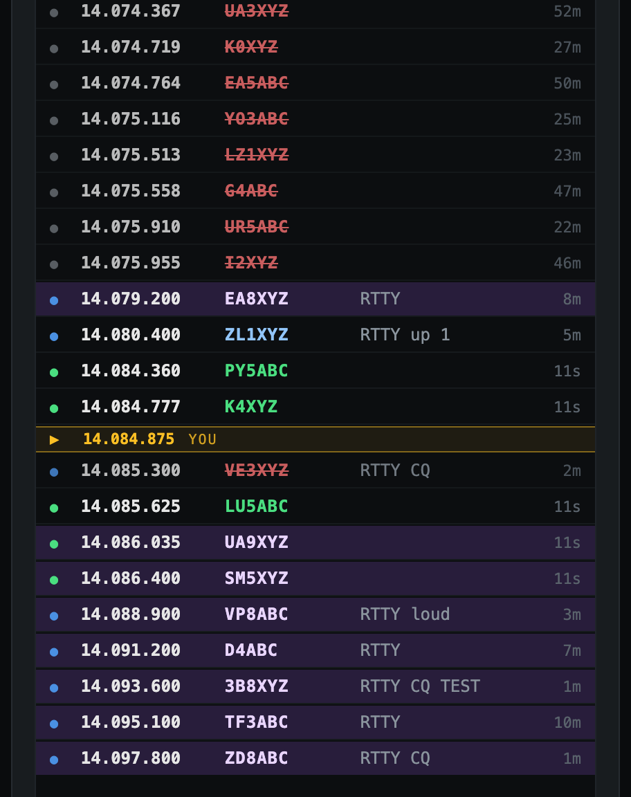

# 4. Bandmap and DX cluster



## The bandmap

The bandmap lists every station Diddle knows about, sorted by frequency, with a **▶ YOU** marker at your own frequency:

- **Blue dot:** a DX cluster spot, with the spotter's comment.
- **Green dot:** a station Diddle decoded on the waterfall.
- **Purple row:** a new multiplier on that band.
- **Red, struck through:** already worked on that band.
- **Age** on the right: how long ago the station was last spotted or heard.

**Click a row** to load the call into the entry form, tune so the station lands on your mark tone (DIGL-aware), and switch to **S&P**. The page doesn't scroll when you do this.

As you tune, the list keeps your **YOU** marker in the middle, unless you've just scrolled the list yourself.

| Control | What it does |
|---------|--------------|
| **20m only / all bands** | Shows only the band the radio is on, or everything. |
| **docked / dock** | Puts the bandmap (with Score above it) in a full-height column on the right that stays on screen, or back in the main column. Needs a window about 1100 px wide. |
| **clear** | Empties the bandmap. Your log isn't touched, and new spots keep arriving. |

<br clear="right">

## The DX cluster

Diddle connects to a telnet DX cluster to get spots. Set it up in **Settings → DX cluster**:

- **Host / Port:** the default is `dxc.k1ttt.net:7373`. Any DX Spider, AR-Cluster or CC Cluster node works.
- **Connect / Disconnect:** logs in with your call.
- **Commands sent after login:** one per line, sent every time Diddle logs in. This is the place for filters, so you only get RTTY spots:

  ```
  set/filter mode rtty
  set/filter band hf
  ```

  (Filter syntax differs between cluster types; check your node's help.)

The **`dx›` line** under the bandmap sends any command straight to the cluster, for example `sh/dx 20` or `sh/filter`. **↑ / ↓** recall earlier commands, and **Esc** clears the line.

Next: **[Score, logs and exports →](05-score-logs.md)**
