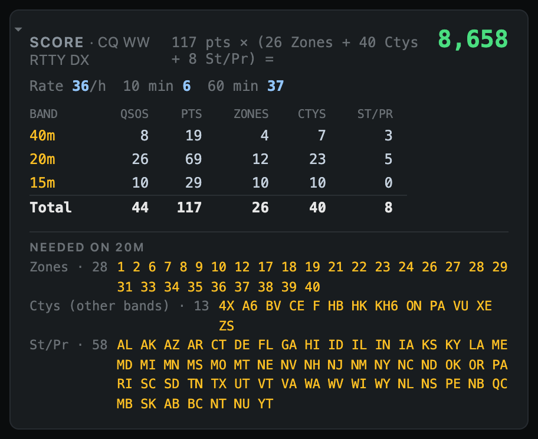
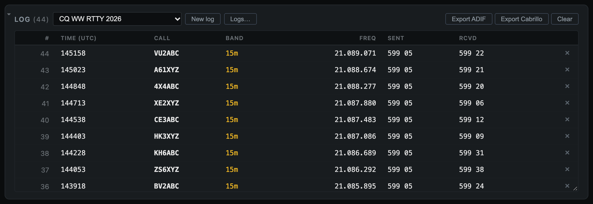

# 5. Score, logs and exports

## Score

The **header** always shows QSOs, score, rate and elapsed time. The **Score panel** has the detail:

- **The claimed score**, worked out as points × multipliers. Each kind of mult is named, for example `(26 Zones + 40 Ctys + 8 St/Pr)`.
- **Rate:** the hourly rate over the last 10 minutes, and how many QSOs you made in the last 10 and 60 minutes.
- **Band summary:** QSOs, points and mults on each band, with totals. Mults that count once per contest (Roundup, WPX) are listed separately. Dupes aren't counted.
- **Needed on 20m** (the band you're on):
  - **Zones** and **St/Pr** are listed against the full list, so you see exactly what's left.
  - **Ctys (other bands)** are countries you've worked on another band but not this one. These are the easy ones to pick up when you QSY.

Logging a new multiplier flashes **NEW MULT** in the entry window and plays a chime. Settings → *Chime on a new multiplier* turns the sound off.

How each contest is scored:

| Contest | Points | Multipliers |
|---------|--------|-------------|
| CQ WW RTTY | 1 own country, 2 same continent, 3 other continent | Zones + countries + W/VE states/provinces, per band |
| CQ WPX RTTY | 1 / 3 (doubled on 40–160 m) | Prefixes, once |
| ARRL RTTY Roundup | 1 | States/provinces + DXCC, once |
| NAQP RTTY | 1 | States/provinces + NA countries, per band |
| JARL RTTY | 2 same continent, 3 other | Countries + JA/W/VE/VK call areas, per band |
| Makrothen RTTY | Distance between grid squares × band factor | None |

The rules are implemented in outline. Check the sponsor's current rules before you rely on a claimed score.

## Logs

Each contest gets **its own log**. The menu at the top of the Log panel shows which log is open.

- **New log:** starts an empty log for a contest or a saved setup. The current log is kept.
- **Logs…:** lists every log. From here you can open an earlier one, rename it, delete it, or use **Import ADIF…** to read an ADIF file (a Diddle export or another logger's) into a new log.
- **Opening a log** brings back its contest and saved setup.
- **Clear** deletes every QSO in the open log; click twice to confirm. To start a new contest, use **New log** instead.

Click a call, frequency or exchange in the table to edit it, and click **×** to delete a QSO. Logs save automatically after every change.

Logs are stored in Diddle's data folder:

| System | Folder |
|--------|--------|
| macOS | `~/Library/Application Support/com.diddle.app/logs/` |
| Windows | `%APPDATA%\com.diddle.app\logs\` |
| Linux | `~/.local/share/com.diddle.app/logs/` |

## Exports

- **Export ADIF:** a standard `.adi` file. Each exchange part has its own field (`CQZ`, `STATE`, `SRX`, `NAME`, `PFX`…), the way N1MM+ and WriteLog import it. Use it for LoTW, Club Log or your main logbook.
- **Export Cabrillo:** the contest submission file. Its header includes the claimed score, and its `QSO:` lines are laid out for the contest. Check the header fields (category, operators and so on) before you upload.

## Sending QSOs to other software (UDP)

**Settings → Send QSOs over UDP** sends each QSO to other programs on your network as you log it:

- **WSJT-X format** (default port 2237): for World Radio League's desktop app, Log4OM, GridTracker and JTAlert.
- **N1MM format** (default port 12060): for N1MM-aware tools. Edits and deletes are sent too.

Each format takes a list of `host:port` addresses separated by commas, and broadcast addresses work. Both are off until you switch them on.

Next: **[Practice without a radio →](06-practice.md)**
