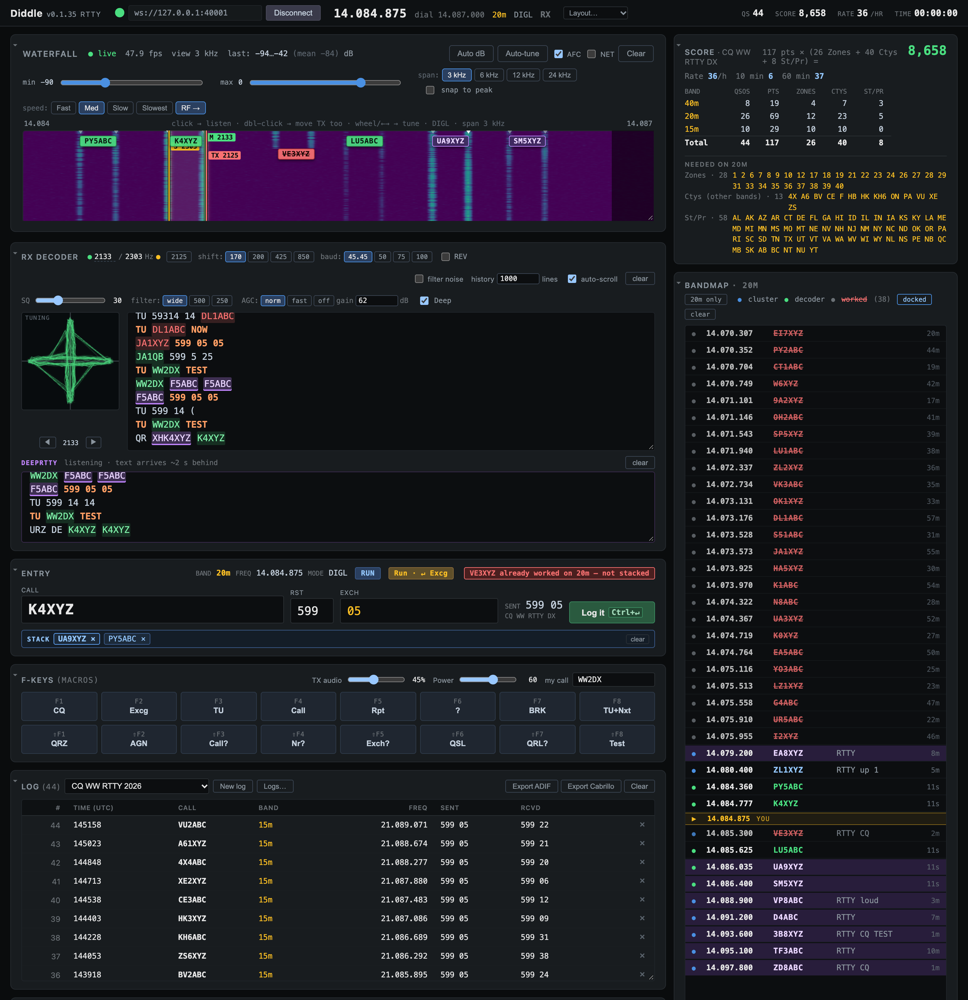

# Diddle User Manual

Diddle is a RTTY contest logger for TCI radios: ExpertSDR / SunSDR, RemoteHamRadio and compatibles. It decodes and sends RTTY itself, so there's no MMTTY, no soundcard routing and no FSK interface. One app talks to the radio over one network connection.

This manual covers everything on screen and every key, in the order you'll need them.

## Contents

1. **[Getting started](01-getting-started.md)**: install, connect to the radio, enter your station details, pick a contest, and a tour of the screen.
2. **[Receiving](02-receiving.md)**: the waterfall, the RX decoder, DeepRTTY, the tuning scope, AFC, filters and squelch.
3. **[Operating](03-operating.md)**: the entry window, Run and S&P, ESM (Enter Sends Message), the caller stack, F-key macros and live keyboard sending.
4. **[Bandmap and DX cluster](04-bandmap-cluster.md)**: spots, decoded stations, click-to-QSY, and cluster commands.
5. **[Score, logs and exports](05-score-logs.md)**: score, rate and needed mults; managing logs; ADIF and Cabrillo; sending QSOs to other software.
6. **[Practice without a radio](06-practice.md)**: the contest simulator, audio-device input, and WAV playback.
7. **[Keyboard reference](07-keyboard.md)**: every shortcut on one page.
8. **[Troubleshooting and FAQ](08-troubleshooting.md)**

## The five-minute version

1. Turn on the TCI server in your radio software. Start Diddle, check the URL in the header (default `ws://localhost:40001`), and click **Connect**.
2. Open **Settings** at the bottom of the page. Enter your call, name, state, zone and grid, and pick the contest.
3. Click a station on the waterfall to copy it. Click a decoded callsign to put it in the Call field.
4. Press **Enter** to work it. With ESM on, each Enter sends the next message and the last one logs the QSO. The chip next to the entry fields always shows what Enter will do.
5. Press **Esc** to stop a transmission.

> This manual describes the current version of Diddle. Features change quickly while Diddle is at v0.1. If something on your screen doesn't match, check the [changelog](../../CHANGELOG.md).
